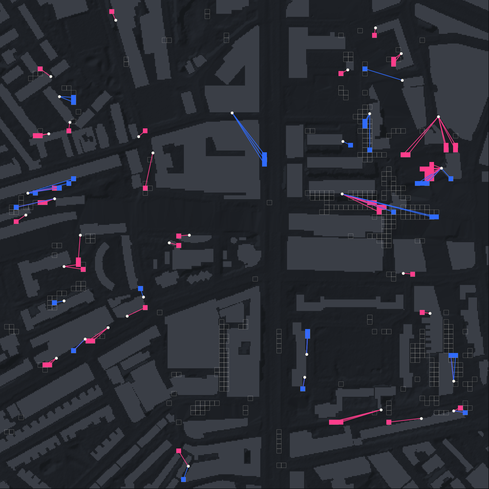
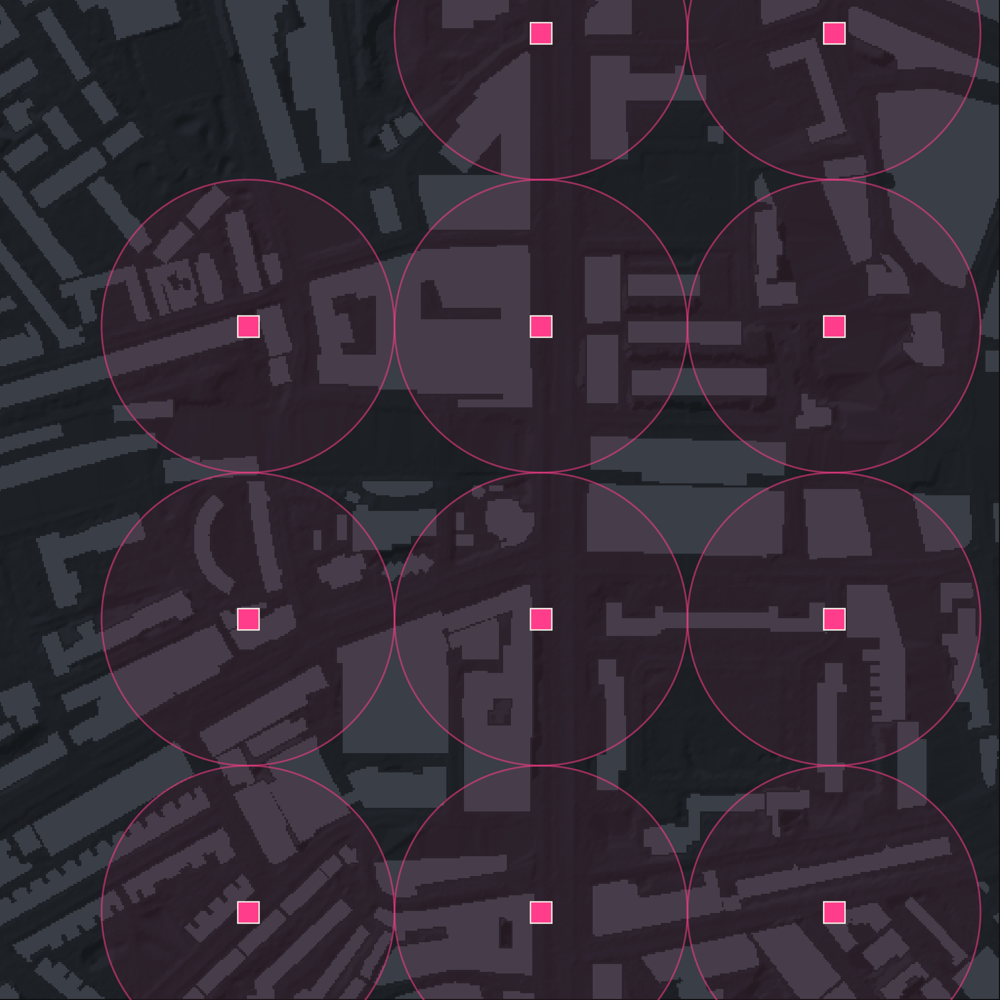

# Which ground floods a building? An exhaustive terrain-sensitivity map of an urban street in a 2D flood solver, by packing spatially independent scenarios into one simulation

*Entry to the SoTA Scientific Parallelism Hackathon, London, 21 to 22 November 2026. Challenge: flood uncertainty.*

[Open the interactive Blackfriars 3D experiment](docs/blackfriars-simulation.html) — download the HTML and open it in a browser to explore spatial packing, fast-fill screening and the five-square street design.

## Abstract

Surface-water flood maps show where water goes in a storm. They do not show which ground is responsible, which is what is needed to fix a street or to know where the height data must be trusted. We answer that question directly for a 512 m square of central London at 1 m resolution: every 5 x 5 m square of open ground (7,894 of them) is raised and lowered by 5 cm in a 2D shallow-water solver, and the change in peak water depth is recorded at 207 points on building edges. The existing way to do this is one simulation per change, 15,788 simulations. Running more simulations at once gave no gain, because one already saturates the GPU. We instead use the physics: a 5 cm change moves water only nearby (median 20 m), so changes 150 m apart can share one simulation. The whole map took 1,800 simulations, 8.77 scenarios per simulation, or 1,956 and 8.07 with every confirmation run counted: about 7 GPU-hours on two laptops against about 55 for one at a time, with the same solver, grid and storm. We find that 98 scenarios on 84 squares (1.06% of squares) move a building's peak water by 1 cm or more, typically 20 m away, 60 deeper and 38 shallower. All pass lines were written down before the runs. Four failed and are reported: about 1 move in 20 travels further than the 75 m we assumed, along ponds, so re-running each finding apart from the others is a required step; a fast fill model finds only 77% of the ground that matters; and only 53 of the 98 findings persist at twice the rain, so the map must be made per storm.



**Figure 1.** The result. Each coloured square is a 5 x 5 m patch of open ground whose 5 cm change moves the peak water at a building by 1 cm or more in the solver (pink: deeper; blue: shallower). Lines join each square to the building it moves. Faint outlines are the ground a fast fill model flagged. Buildings are grey. 35 mm storm.

## 1. Introduction

The Environment Agency's 2024 national assessment counts 4.6 million properties in England in areas at risk from surface water, against 2.4 million from rivers and the sea. Surface-water flooding is decided at street scale: rain that the drains cannot take fills a dip, spills over its lowest lip, and collects against a building somewhere else. Height errors of a few centimetres, the size of a kerb, are therefore the scale that matters.

The organisers' question is which scientific questions could be investigated if computation ran at greater scale. Ours is: for each building, which ground sets its flood? Flood risk is uncertain in the rain and in the ground. The rain axis is the standard ensemble. The ground axis needs one scenario per patch of ground and per direction of change, and in a hydrodynamic model the published practice is one simulation per scenario (a study of where green space matters ran the CityCAT model once per cell per storm, arXiv:2311.00420).

Contributions:

1. An exhaustive map, in a 2D solver, of which 5 x 5 m squares of a real street move the peak water at a building.
2. A reshaping that makes it affordable on two laptops: scenarios that cannot reach each other are packed into one simulation. This is the colouring idea used for sparse Jacobians since Curtis, Powell and Reid (1974), applied to flood scenarios. We did not find it used for this purpose.
3. A measurement of where the reshaping stops working (long ponds), and a confirmation step that catches it.
4. Negative results reported against lines fixed in advance.

## 2. Methods

### 2.1 Site and data

A 512 x 512 m tile at 1 m resolution around Blackfriars Road and Southwark station, from the Environment Agency LIDAR composite. 65% of cells are open ground; the rest are buildings. 207 receptors are points on building edges. A building counts as flooded at a peak depth of 0.10 m.

### 2.2 Solver

A batched 2D local-inertial shallow-water solver (Bates et al. 2010; the scheme of LISFLOOD-FP) with semi-implicit Manning friction and a positivity-preserving flux limiter, written in MLX for the Apple GPU in single precision (`solver/flood.py`). Each batch member has its own terrain, rain series and adaptive time step. It agrees with a pre-existing JAX reference to 0.002 mm, conserves mass to 1e-5, and is bit-identical across batch sizes on one machine. One run of the tile takes 11 to 15 s.

### 2.3 The experiment

For every 5 x 5 m block of the tile containing open ground (7,894 blocks, outermost ring excluded), the open cells are raised by 5 cm, and separately lowered by 5 cm, giving 15,788 scenarios. Each is simulated for a 35 mm one-hour storm with a 12 mm/h loss. A scenario is a *mover* if it changes the peak depth at a receptor more than 7.5 m away by 1 cm or more.

### 2.4 Packing



**Figure 2.** One real simulation of the map. The eleven pink squares were all changed in the same run; circles have a 75 m radius.

Blocks are coloured by (row mod 30, column mod 30). All blocks of one colour, 150 m apart, are changed in the same simulation: 900 simulations per direction, 8.77 scenarios each. A receptor that moves is attributed to the nearest changed block; if that block is more than 75 m away the move is recorded as unattributed. The spacing was fixed before launch from 276 earlier single-scenario runs, and colours were run in a fixed random order so that any prefix is a uniform sample.

### 2.5 Confirmation

Every mover was re-run apart from its original partners: 73 alone, and all 103 repacked 300 m apart. Every move the packed map could not place was traced with single runs of each candidate block (30 runs).

### 2.6 Baseline and what is held fixed

The baseline is one simulation per scenario: the same solver, laptops, storm, grid, scenarios and 1 cm criterion. Only the number of scenarios per simulation changes. The baseline cost is the measured mean time per simulation times 15,788; it is extrapolated, not run. The factor is per storm.

### 2.7 Lines fixed in advance

Every pass line was committed to this repository before the run it judges (`docs/G_CRITERIA.md`; the git history carries the timestamps). Thresholds were not changed after scoring.

## 3. Results

### 3.1 Cost

| | Simulations | Scenarios per simulation | GPU-hours (two laptops) |
|---|---|---|---|
| One scenario per simulation (extrapolated) | 15,788 | 1 | about 55 |
| Packed map | 1,800 | 8.77 | 6.3 |
| Packed map with all confirmation and trace runs | 1,956 | 8.07 | 6.9 |

Running several simulations in one batch did not raise throughput per cell on either laptop: a single 512 x 512 run already saturates the GPU. The gain comes only from packing.

### 3.2 The map

- 98 of 15,788 scenarios (0.62%) are movers, on 84 of 7,894 squares (1.06%); 14 squares are movers in both directions.
- 60 make a building's peak water deeper and 38 shallower. 39 receptors are affected. 16 scenarios take a receptor across the 0.10 m flood line, 8 in each direction.
- Distance from the square to the building: median 20 m, 90th percentile 49 m; 86% are more than 10 m away. Effect: median 1.7 cm, largest 7.8 cm.

### 3.3 Checks against lines fixed in advance

| Check | Line | Result | Verdict |
|---|---|---|---|
| Mass imbalance in every run | at most 5e-5 | 1.2e-5 | Pass |
| Unchanged run identical at start and end, per machine | identical | identical | Pass |
| 276 earlier single runs keep their verdict in the map | at least 95% | 274 (99.3%) | Pass |
| Movers re-run alone keep their verdict | at least 90% | 68 of 73 (93%) | Pass |
| Movers repacked 300 m apart keep theirs | at least 90% | 96 of 103 (93%) | Pass |
| Median difference in the change on re-run | at most 1 mm | 0.00 mm | Pass |
| Moves with no changed block within 75 m | at most 2% | 18 of 379 (4.75%) | **Fail** |
| A design chosen only from the map (five squares, one run): targets fall 1 cm, no receptor rises 1 cm, additive to 5 mm | all three | fell 1.8 to 6.5 cm; largest rise 0.24 cm; additive to 0.18 mm | Pass |
| Movers persist at the 70 mm storm | at least 66 of 98 | 53 | **Fail** |
| Movers persist with Manning n doubled (0.03) | at least 66 of 98 | 81 | Pass |
| Movers persist with synthetic road inlets in place of the uniform loss | at least 66 of 98 | 79 | Pass |
| 120 dismissed scenarios, each run alone, move a receptor 1 cm | 0 | 0 (largest change 0.80 cm) | Pass |
| Re-map with squares 75 m apart, lowered half (225 simulations, 35.1 scenarios each): known lowered movers seen; unexplained moves after tracing | at least 95%; zero | 34 of 34; zero (one traced: 0.996 cm alone) | Pass |
| Re-map 75 m apart, raised half: stopped by the clock at 167 of 225 simulations (35.8 scenarios each) | at least 95% of known raised movers seen; zero unexplained | 38 of 38 in the simulations done; zero | No verdict (incomplete) |
| Ten times a 5 mm change names the movers (a small-perturbation slope, the quantity an adjoint computes; not an adjoint run) | at least 90% | 54 of 98 (55%) | **Fail** |
| The same slope falsely flags dismissed scenarios | at most 1% | 0 of 120 | Pass |
| Fast fill model flags the movers | at least 80% | 75 of 98 (77%) | **Fail** |
| Fast fill model wrongly dismisses | at most 1% | 0.15% | Pass |

All runs stopped at 11:00 on Sunday. Two checks were unfinished and carry no verdict: the raised half of the 75 m re-map (167 of 225 simulations) and the packed map at the 70 mm storm (59 of 161 simulations, not scored). The 75 m re-map raised 37 candidates for a confirm run in the lowered half and 48 in the part of the raised half that ran; those confirm runs were not made, so the reported speedup remains 8.1x at 150 m. The synthetic inlets (303, the lowest road cell in each 25 m square, together able to take what the uniform loss could) are not real drainage. No recorded flood could be compared: the London Fire Brigade logged no flooding call-out inside the tile on 12 July 2021 and one, 14 m outside it, on 25 July 2021.

### 3.4 Why the 75 m line failed

The 18 unattributed moves and the 7 movers that did nothing when re-run alone have one cause. A block that changes the level of a long pond moves receptors 76 to 124 m away, and the nearest-block rule then names the wrong block. All 25 cases were reproduced, to within 2 mm, by one block of the same colour run alone. The packed simulations therefore add up correctly; what fails is naming the block by distance. The confirmation step caught every wrong name, and is part of the method.

### 3.5 Use: a design that harms no one

Five squares were chosen from the map alone, each lowering one building and raising no receptor by more than 3 mm in its single run. Changed together in one simulation, the five buildings fell by 1.8 to 6.5 cm, no receptor rose by 1 cm, and every receptor's change matched the sum of the single effects to 0.18 mm. An earlier design chosen for benefit alone from the fill model raised the water by 1 cm or more at seven receptors. These are two designs, not a general result.

## 4. What did not work

- **Batching simulations.** No gain per simulation on this hardware.
- **A fast fill model as a filter.** An exact depression-tree model (fill, spill, merge; `fill/`) evaluates all 342,316 single-cell scenarios in ten minutes. As a screen for the solver map it finds 77% of movers (an older rule: 43%), under the 80% line. It also failed three times to predict the size of a change. It is a prior for where to look first, not a substitute.
- **Pooled screening.** Testing a hundred squares per run and splitting the pools that respond (group screening, Bettonvil and Kleijnen 1997) failed: the method needs effects of known sign, and ours go both ways.
- **A derivative in place of the experiment.** Ten times the effect of a 5 mm change names 55% of the movers found with 5 cm, and predicts a median 0.71 of the true effect (quartiles 0.24 to 1.26). Kerb-sized changes are not small for this flow, so a first-order sensitivity would not have produced this map. We did not build an adjoint solver.
- **Transfer between storms.** 53 of 98 movers persist at 70 mm. Each rainfall scenario needs its own map.

## 5. Assumptions and limitations

- One neighbourhood. No observed rain flood at this site to validate against; the only large flood on record was a burst water main.
- Sewers are a constant 12 mm/h removed from the rain. Rain is uniform over the tile. Roof water is not routed to the street.
- Buildings are solid walls. In the fill model, making them floodable footprints leaves 28 of 29 buildings with some of the same controlling ground.
- Manning's n is 0.015 everywhere and uncalibrated.
- Water cannot enter from outside the tile.
- The result is sensitivity of a 2D solver to its terrain. Absolute depths and thresholds in millimetres are not claimed.
- 150 m spacing does not isolate every scenario; see 3.4.
- The two laptops differ by 0.03 mm in the unchanged run; each simulation is compared with the unchanged run from its own machine.

## 6. Related work

Depression hierarchies and fill-spill-merge give the rain that floods a point without a hydrodynamic model (the Danish Blue Spot method; SCALGO Live; Rav, Lowe and Agarwal 2017; Barnes et al.). We use such a model only as a prior. Sparse-Jacobian estimation by perturbing structurally independent columns together goes back to Curtis, Powell and Reid (1974), with the graph-colouring view surveyed by Gebremedhin, Manne and Pothen (2005). The per-cell hydrodynamic study we take as the baseline practice is arXiv:2311.00420. Our literature search was limited to the weekend; we say "we did not find", not "first".

## 7. Reproducing

```
uv run --with mlx --with numpy python fill/map_run.py raise air      # 900 packed simulations, resumable
uv run --with mlx --with numpy python fill/map_run.py lower pro
uv run --with mlx --with numpy python fill/map_confirm.py raise air  # confirmation
uv run --with numpy python fill/map_score.py                         # every line in section 3.3
uv run --with mlx --with numpy python fill/map_trace.py              # trace unplaced moves
uv run --with numpy python fill/map_trace_score.py                   # final list
uv run --with numpy --with matplotlib python fill/map_figure.py      # Figure 1
```

Per-simulation results are in `results/air/map` and `results/pro/map`. The one-page status of every finding is `docs/FINDINGS.md`; the lines and verdicts are `docs/G_CRITERIA.md`; working logs are in `status/`.

## Compute disclosure

All results come from two laptops (M4 MacBook Air, M3 MacBook Pro). Before the limit to provided compute was set, one 20-second port check ran on a rented A100. No number from it is used.

## References

- Bates, P. D., Horritt, M. S., Fewtrell, T. J. (2010). A simple inertial formulation of the shallow water equations for efficient two-dimensional flood inundation modelling. *Journal of Hydrology* 387.
- Bettonvil, B., Kleijnen, J. P. C. (1997). Searching for important factors in simulation models with many factors: sequential bifurcation. *European Journal of Operational Research* 96.
- Curtis, A. R., Powell, M. J. D., Reid, J. K. (1974). On the estimation of sparse Jacobian matrices. *IMA Journal of Applied Mathematics* 13.
- Environment Agency (2024). National assessment of flood and coastal erosion risk in England 2024.
- Gebremedhin, A. H., Manne, F., Pothen, A. (2005). What color is your Jacobian? Graph coloring for computing derivatives. *SIAM Review* 47.
- arXiv:2311.00420. Per-cell hydrodynamic (CityCAT) analysis of where green space reduces urban flooding.

## Context: the hackathon brief

SoTA Scientific Parallelism Hackathon (Society for Technological Advancement, supported by Callosum, Inherent Labs, ARIA and Fractile). Headline question: "Which scientific questions could we investigate better if computation were faster or could run at a greater scale?" Judging: correctness and assumptions; fundamental reshaping; meaningful speedup against a credible baseline; scientific value. Informative negative results count.
